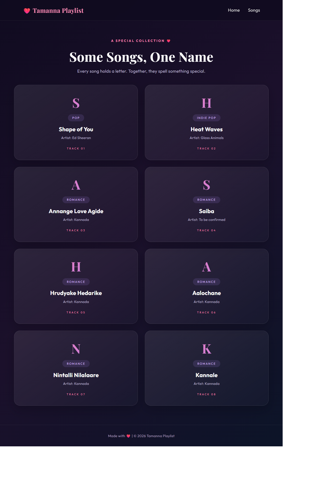

# Tamanna Playlist

A personalized music playlist web application developed using Node.js, Express.js, and EJS. The application presents a curated collection of songs through a clean, elegant, and responsive user interface.

## Overview

Tamanna Playlist is a web-based application designed to transform a traditional song collection into a personalized digital experience. It uses server-side rendering to dynamically display song information and provides simple navigation between the homepage and playlist.

## Screenshots

### Homepage


### Playlist


## Features

- Personalized homepage with a dedicated welcome section.
- Curated collection of songs.
- Dynamic song rendering using EJS templates.
- Individual song cards with letter-based presentation.
- Dedicated homepage and playlist routes.
- Custom CSS styling and responsive layout.
- Simple and intuitive navigation.

## Technology Stack

| Technology | Application |
|---|---|
| Node.js | JavaScript runtime |
| Express.js | Server-side application framework |
| EJS | Dynamic HTML templating |
| HTML5 | Page structure |
| CSS3 | Styling and layout |
| Git | Version control |
| GitHub | Source code hosting |

## Project Structure

```text
Tamanna-Playlist/
│
├── public/
│   ├── screenshots/
│   │   ├── home page.png
│   │   └── playlist.png
│   └── style.css
│
├── views/
│   ├── index.ejs
│   └── songs.ejs
│
├── app.js
├── package.json
├── package-lock.json
├── .gitignore
└── README.md
```

## Installation and Setup

### Prerequisites

- Node.js
- npm
- Git

### 1. Clone the repository

```bash
git clone https://github.com/Tamanna040606/Tamanna-Playlist.git
```

### 2. Navigate to the project directory

```bash
cd Tamanna-Playlist
```

### 3. Install dependencies

```bash
npm install
```

### 4. Start the application

```bash
node app.js
```

### 5. Access the application

Open your browser and visit:

```text
http://localhost:3000
```

## Application Routes

| HTTP Method | Endpoint | Description |
|---|---|---|
| GET | `/` | Displays the homepage |
| GET | `/songs` | Displays the song collection |

## Learning Outcomes

This project demonstrates practical implementation
